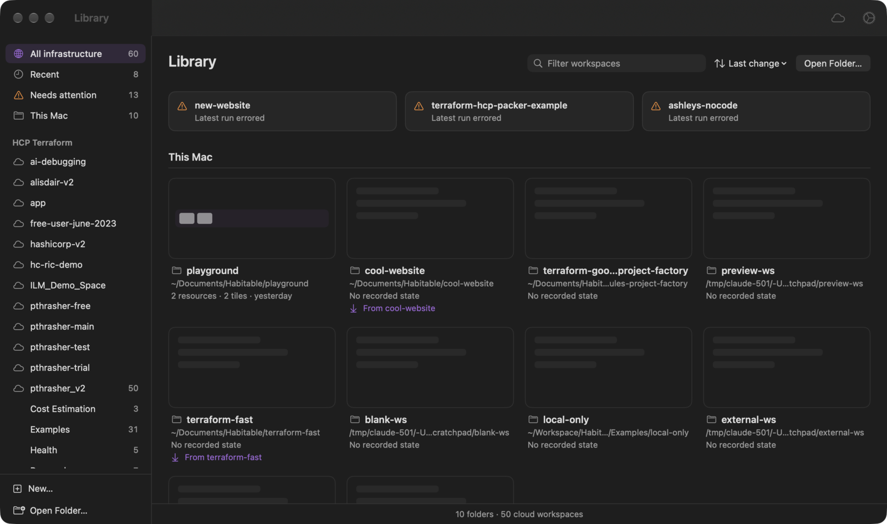
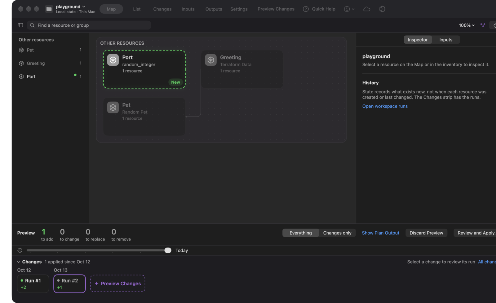
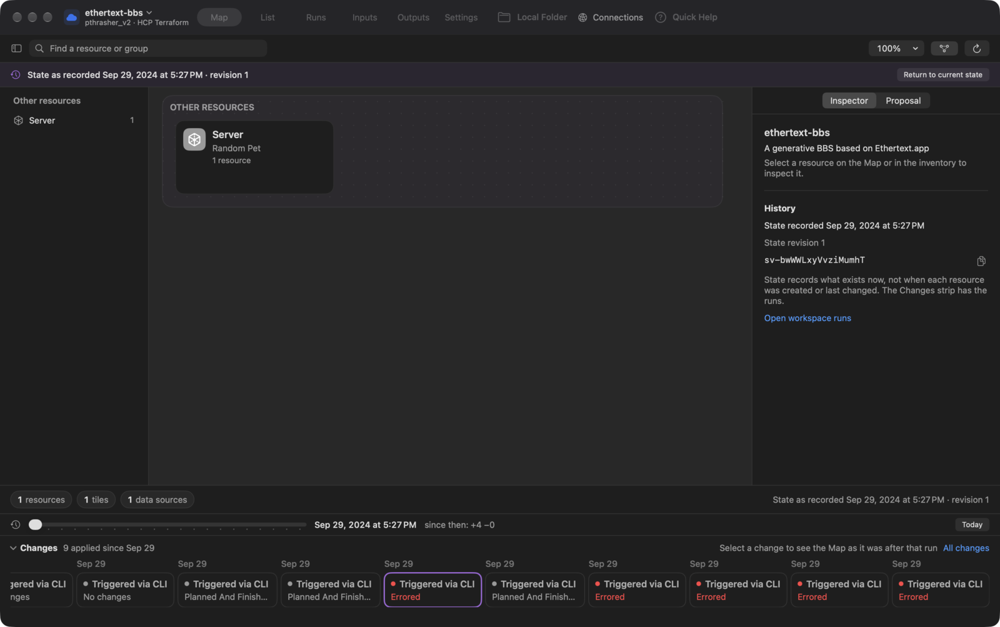
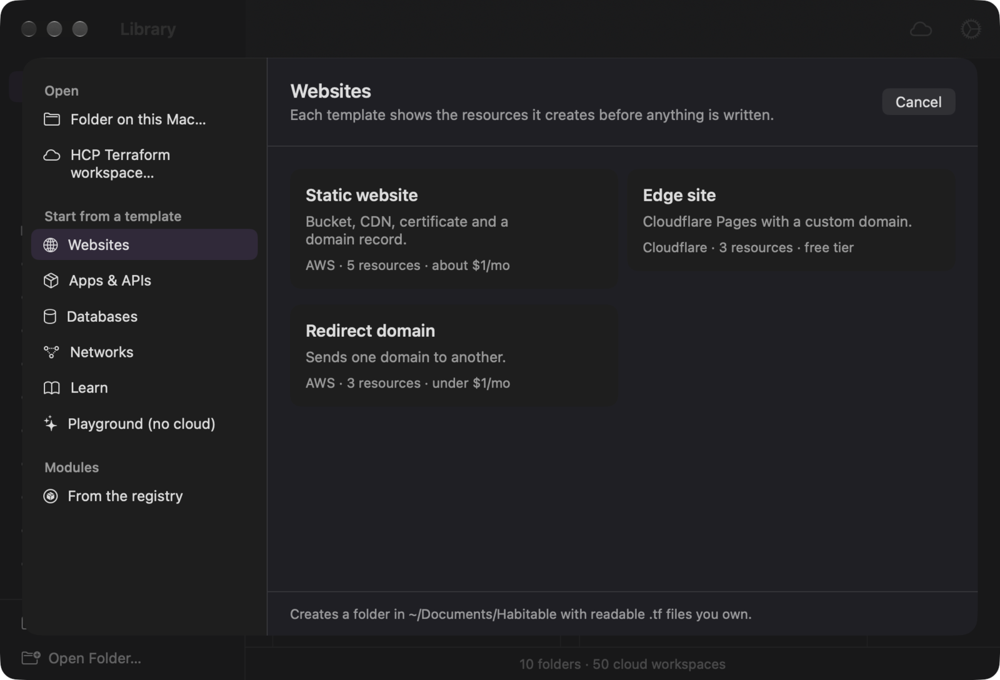
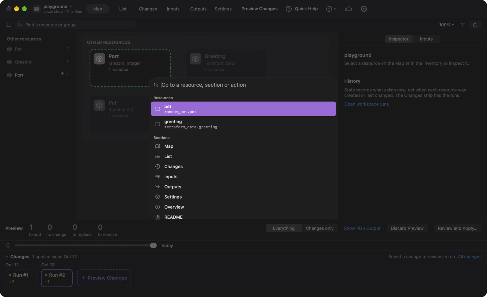
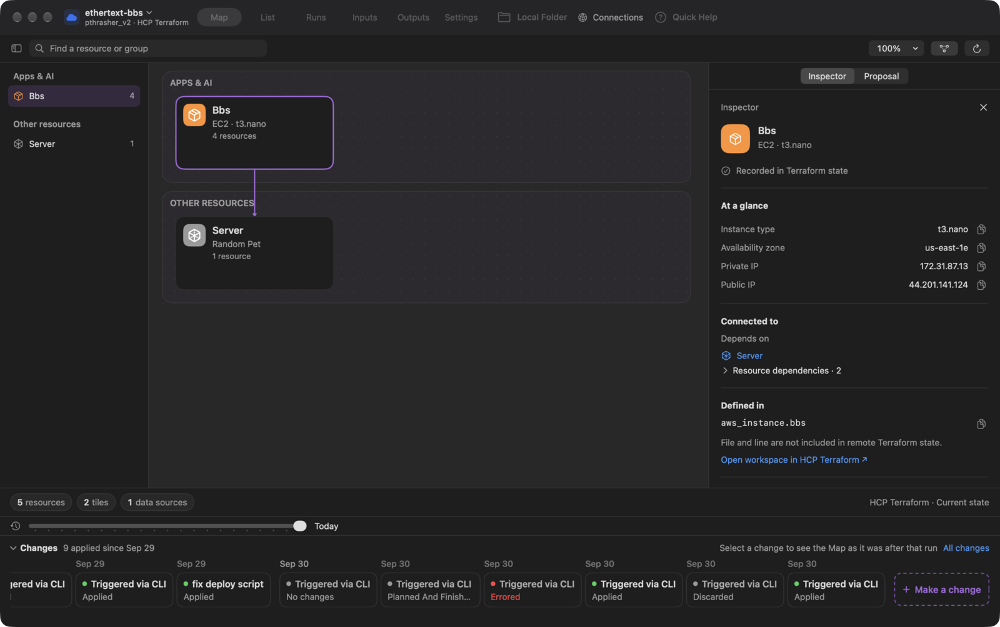

# Habitable

A native macOS app for infrastructure, not code. Your Terraform resources on a map, with configuration and runs as supporting detail. Works with folders on this Mac and HCP Terraform workspaces. Habitable never applies from your Mac: runs happen in HCP Terraform, or in a local folder you confirm, and you review every change on the Map first.



## What's in 0.6.0

**The Library is home.** One window lists every folder you have opened and every HCP Terraform workspace you can reach, with status, project and tags. Needs attention gathers errored runs and drift. Remove a folder from the Library without touching it on disk.

**One shape for every workspace.** Each workspace window starts with its name and where it lives, "Local state · This Mac" or "pthrasher_v2 · HCP Terraform", then the same rail: Map, List, Changes (Runs in the cloud), Inputs, Outputs, Settings. The name is also the switcher: other folders on this Mac, or other workspaces in the organization.



**Preview Changes on the Map.** Press Preview Changes and the Map switches into review: new things outlined green, changes amber, replacements pink, removals red, with the counts beside the decision and Everything or Changes only. The Inspector shows what changes for a resource, attribute by attribute. Review and Apply opens the saved plan; replacements and removals in the cloud need a press-and-hold to confirm.

**Time travel.** A playhead under the Map. Drag it and the Map shows the workspace as it was after each recorded state, tiles arriving and leaving, with "since then: +a −r" beside the date. In the cloud this reads HCP state versions. On this Mac, Habitable records each distinct state read, with sensitive values stripped, under Application Support; nothing is written into your folder.



**Changes that arrive.** During an apply, each tile shows a ring while Terraform works on it, a settle when it lands, and a shake if it fails.

**Drift you can see.** A resource that changed outside Terraform gets an amber pulse on the Map, a Drifted status in the List, a diamond on the change card, and an Inspector section with before and after. Put it back reviews the plan that restores the code's version. Keep it and update code opens the declaration with the live values on the clipboard.

**Making changes in HCP Terraform.** The Proposal face starts a change from a folder on this Mac. For a repository-backed workspace Habitable creates the branch, commits, pushes and opens the pull request, then follows its checks, reviews, merge and the run it starts. For an API-driven workspace it uploads the folder and starts the run. The plan lands on the Map like a local preview, and you confirm the apply from Habitable. Runs show HCP's stages: plan, policy, cost, tasks, apply, outputs.

**New infrastructure.** File › New Infrastructure… (⌘⇧N) is a chooser in the GarageBand shape: open a folder or a workspace, start from a template (websites, apps, databases, networks, learn, a no-cloud playground), or search the public Terraform Registry for a module. Each template shows what it creates and a rough monthly cost before anything is written. Create Folder writes readable `.tf` files you own, with a README that links back to the source.



**Power users.** The List is the same workspace as a dense, sortable table with filter tokens like `type:aws_* module:edge status:changed`. Go to Anything (⌘K) reaches every resource, section and action. Quick Help (⌘⇧/) explains whatever you hover.



**Native everywhere.** A menu bar extra lists runs waiting for your approval, runs in flight and drifted workspaces, checked every minute, with notifications you can act on. Shortcuts and Siri can check a workspace for drift or open it. Spotlight indexes resource names, addresses and endpoints. Ask Claude in the Inspector hands Claude a question about a resource with the shape of the change and never a value.



## Golden workflows

**Local folder: see it, preview a change, apply it.**

1. Open a Terraform folder: New Infrastructure…, Open Folder…, a Library card, Finder's Open With, a drop on the Dock icon, or `open -a Habitable <folder>`. Folders opened from inside the app initialize on first open (Settings › General); a folder handed in from outside asks first, since init downloads and runs the providers it declares.
2. The Map shows what exists, grouped by what it does. A folder with no state yet shows what it declares: "Declared, not built."
3. Edit configuration in your editor ("Defined in" opens the file). Press Preview Changes.
4. Review and Apply… opens the saved plan; apply from there. The Changes strip below the Map records every run.

**HCP Terraform workspace: browse, review, and bring it to this Mac.**

1. Sign in once in Settings › Connections. The Library then shows each organization and every workspace with its latest run status.
2. Open a workspace. Runs lists its history with who started each run and from where. Inputs shows variables and variable sets; private values stay hidden. Outputs shows the current state's outputs. Settings changes the Terraform version, execution mode, working directory, auto-apply, description and lock.
3. Check Out… clones a repository-backed workspace into `~/Documents/Habitable` and opens it as a local folder. The two windows link to each other.
4. Make a change from the Proposal face, review the plan on the Map, confirm the apply.

## Install

Download the signed and notarized universal app from [GitHub Releases](https://github.com/thrashr888/homebrew-tap/releases?q=habitable), or install with Homebrew:

```sh
brew install --cask thrashr888/tap/habitable
```

Upgrade with:

```sh
brew upgrade --cask thrashr888/tap/habitable
```

Requires macOS 13 or later. The universal app supports Apple silicon and Intel. Download a Terraform CLI from Settings › Terraform after launching, or use one already on this Mac.

## Try without cloud infrastructure

New Infrastructure… › Playground creates a folder with two harmless resources that run on this Mac. Or copy `Examples/local-only` to a scratch directory and open that folder.

```sh
cp -R Examples/local-only /tmp/habitable-demo
```

## Run in Xcode

Requires macOS 13 or later, Xcode 27, Go (for the bundled configuration helper), and a Terraform CLI downloaded in Settings or installed locally.

1. Open `Habitable.xcodeproj` and let Swift packages resolve.
2. Select the Habitable scheme and My Mac, then press ⌘R. Local builds use Sign to Run Locally; no developer team is required.

## Terraform versions

Settings › Terraform loads compatible stable releases from HashiCorp's [official release catalog](https://releases.hashicorp.com/terraform/). Choose a version and click Download and use. Habitable downloads the archive and SHA-256 checksum list over HTTPS, verifies the archive, extracts only the Terraform executable, and checks its reported version before activating it. Downloads live under `~/Library/Application Support/Habitable/Terraform`. Use system Terraform returns to CLI discovery: `HABITABLE_TERRAFORM_PATH`, then `PATH`, `/opt/homebrew/bin`, and `/usr/local/bin`.

## What stays on this Mac

Run history is saved per folder under `~/Library/Application Support/Habitable/RunHistory`, with owner-only permissions. Values marked Sensitive are redacted from logs, errors, history and plan reviews. State recordings for time travel strip every value Terraform marks sensitive before they are written. Remembered inputs live in the keychain. Habitable reads the HCP Terraform credential from `~/.terraform.d/credentials.tfrc.json` or the one you enter in Connections, and never writes it anywhere else.

Agent access (Settings › Agents) runs a local MCP server so Claude and other agents can read the open workspace's declarations, state metadata and runs. It is off until you turn it on.

## Build and test

```sh
bash scripts/build-config-inspector.sh
xcodebuild -project Habitable.xcodeproj -scheme Habitable \
  -configuration Debug -destination 'platform=macOS' \
  -derivedDataPath /tmp/habitable-build build
HABITABLE_CONFIG_INSPECT_PATH=<helper path> swift test
HABITABLE_TEST_TERRAFORM="$(command -v terraform)" swift test
```

The Swift package compiles the app's models. Tests cover the Terraform runner, run history, sensitive redaction, release downloads, the Map classifier, the List's filter grammar, templates and Registry modules, state history, and the attention model behind the menu bar. The opt-in integration test runs init, validate, plan, apply and show against a provider-free folder.

## Design

The design is documented in `DESIGN.md` (visual and interaction), `WRITING.md` (words), and `docs/design/` (decisions, explorations, the resource map RFC, information architecture, and the acceptance log for each round).

## Package a release

`scripts/package-release.sh` builds both Mac architectures, signs with Developer ID, submits to Apple, staples the accepted ticket, and creates a ZIP plus `SHA256SUMS`. Set `SIGNING_IDENTITY`, `DEVELOPMENT_TEAM`, and `NOTARY_PROFILE`. Update the version and build number in `Habitable/Info.plist`, run the tests, tag the verified commit, upload the ZIP and checksums to a GitHub release on `thrashr888/homebrew-tap` (tags `habitable-v<version>`), then update the cask with the archive checksum.
